<p align="center">
  <picture>
    <source media="(prefers-color-scheme: dark)" srcset="readme-assets/header-dark.svg">
    
  </picture>
</p>

<p align="center">
  <a href="https://imigost.vercel.app"><b>Live demo</b></a> &nbsp;·&nbsp;
  <a href="https://imigost.vercel.app/extension.html"><b>Chrome extension</b></a> &nbsp;·&nbsp;
  <a href="#features">Features</a> &nbsp;·&nbsp;
  <a href="#getting-started">Getting started</a> &nbsp;·&nbsp;
  <a href="#deploying">Deploying</a>
</p>

<p align="center">
  A fast, installable photo search site with a built-in link-in-bio page builder,<br>
  handy photo tools and a browser extension. No framework and no build step:<br>
  plain HTML, CSS and JavaScript, plus an optional tiny Node server for short links.
</p>

<p align="center">
  <picture>
    <source media="(prefers-color-scheme: dark)" srcset="readme-assets/features-dark.svg">
    
  </picture>
</p>

---

## Features

### Photo search
- Search Unsplash photos, with a "Popular right now" feed on first load
- Masonry grid that keeps photos in place when you press "Show more"
- Full-screen viewer with photographer credit, keyboard arrows and Esc to close
- Loading skeletons, friendly empty and error states
- Mobile-first: two-column grid on phones, swipeable suggestions, touch-sized buttons, notch and safe-area support

### Link page builder (like Linktree)
- Add your handle for Instagram, X, TikTok, YouTube, LinkedIn, GitHub, Facebook, Telegram and WhatsApp, plus email and any website
- Real brand icons on coloured badges
- **36 looks**, filterable by Light, Dark and Colourful. They include gradients, patterned backgrounds (Polka, Notebook, Blueprint), glass, glow and hard-edged button styles, and serif, monospace and handwriting fonts
- **Profile photo:** upload one (cropped to a square and shrunk to about 5 KB in the browser, drag and drop works) or paste a link to one
- Live phone preview while you edit
- Reorder links, validate them as you type, and get a shareable link

### Tools
A **Tools** tab with three tools. The photo tools run entirely in your browser, so photos are never uploaded.

- **Crop for social media:** presets for Instagram (square and 4:5), Stories, Reels and TikTok, YouTube thumbnails, X, LinkedIn, Facebook, Pinterest and profile pictures, plus a custom size. Drag, pinch or scroll to frame, rotate, show a grid, then save as JPG, PNG or WebP at the exact size.
- **Compress, resize and convert:** many photos at once. Choose JPG, WebP or PNG, a quality, and a size (keep, fit within a maximum, or scale by percent). See the before and after size of each photo, then download them one by one or as one ZIP. Saving removes details like location.
- **Internet speed test:** ping, jitter, download and upload, with a live gauge, a "what you can do" summary and your recent results. A shorter test is available for people on limited data.

### Browser extension
A Chrome extension (also works in Edge, Brave and Opera) lives in the `extension/` folder. People get it from the **Get the Chrome extension** button in the site footer, which opens `extension.html` with the download and install steps.

- Right-click any image on the web to **crop it for social media** or **compress and convert it**. It opens in your tool with the image already loaded.
- Right-click a page or link to **add it to your link page**.
- Select text and right-click to **search photos** for it. The toolbar popup also has a search box and quick links.

See [`extension/README.md`](extension/README.md) for how it works, how to point it at your own site, and how to rebuild the ZIP.

### App features
- Installable PWA with an offline page and "Install app" button
- Favicon and home-screen icons
- Cookie consent that actually controls what loads
- Respects dark mode and reduced-motion settings

## Project structure

| File | What it does |
| --- | --- |
| `index.html`, `image.css`, `image.js` | The photo search page |
| `links.html`, `links.css`, `builder.js` | The link page builder |
| `profile.html` | The public page people open from your link |
| `core.js` | Shared logic: platforms, icons, looks, validation, link encoding, rendering |
| `server.js` | Optional Node server for short links (no packages needed) |
| `tools.html`, `crop.html`, `convert.html`, `speed.html` | The tools hub and the three tools |
| `tools.css`, `tools.js`, `crop.js`, `convert.js`, `speed.js` | Tool styles and logic (`tools.js` holds shared helpers and a small ZIP writer) |
| `extension.html`, `extension/` | The extension install page, the extension source, and its ready-to-download ZIP |
| `site.css`, `consent.js` | Cookie banner, install button, offline notice, footer button |
| `pwa.js`, `sw.js`, `manifest.webmanifest`, `offline.html` | Progressive web app files |
| `favicon.svg`, `icons/` | Favicon and app icons |
| `readme-assets/` | The animated images at the top of this README, and the script that makes them |

## Getting started

### 1. Get an Unsplash key
1. Create a free app at [unsplash.com/developers](https://unsplash.com/developers).
2. Open `image.js` and replace the value at the top:

```js
const ACCESS_KEY = "YOUR_UNSPLASH_ACCESS_KEY";
```

Use the **Access Key** only. Never commit the **Secret Key**. The free demo tier allows about 50 requests per hour, so apply for production access before sharing the site widely.

### 2. Run it

The service worker only runs over `http(s)`, so don't open the files by double-clicking. Use a local server:

```bash
# Option A: static (photo search + link pages with long links)
npx serve .

# Option B: with short links like localhost:3000/yourname
node server.js
```

`server.js` needs Node 18 or newer. Then open `http://localhost:3000` (Option B) or the address `serve` prints (Option A).

## How the link page works

1. Open **Link page**, fill in your name, a page name and your links, and pick a look.
2. Press **Create my link** and copy the result.

There are two kinds of link:

| Kind | Looks like | Needs a server? |
| --- | --- | --- |
| **Short link** | `yoursite.com/yourname` | Yes, run `server.js` |
| **Long link** | `yoursite.com/profile.html?u=yourname#…` | No, the page is stored inside the link |

The builder tries the server first and falls back to the long link automatically. A long link is about 400 characters for a typical page.

**Profile photos and long links:** an uploaded photo is saved with short links, but it is too big to fit inside a long link. With a long link the page shows your initial instead, and the builder tells you. Pasting a link to a photo works with both.

**Short link ownership:** the first save returns a private edit key, kept in your browser. Only that browser can change the page later, so nobody can take over your name. Page names must be 3 to 30 characters, and reserved names (like `api` or `links`) are blocked.

**Saved data:** short-link pages are stored in `data/pages.json` (change the folder with the `DATA_DIR` environment variable). The port comes from `PORT` (default `3000`).

## Deploying

| Host | Photo search | Long links | Short links |
| --- | --- | --- | --- |
| Static hosts (Vercel static, Netlify, GitHub Pages) | Yes | Yes | No |
| A Node host (Render, Railway, Fly.io, a VPS) | Yes | Yes | Yes |

- **Vercel** serves the files statically, so `server.js` does not run there. Link pages use long links. Short links on Vercel need serverless functions plus a database such as Upstash Redis.
- **Node hosts** often reset files when they restart, so give `data/` a persistent disk or move storage to a database.

## Installing as an app and offline use

- Browsers that support it show an **Install app** button in the top bar. On iPhone, use Share, then Add to Home Screen.
- Pages you've opened keep working offline. Photo searches need a connection.
- **Important:** whenever you change any site file, bump `VERSION` at the top of `sw.js`. Otherwise visitors who installed the app may keep seeing the old files.

## Privacy

- **Essential storage** (always on): your link-page draft (`linkpage:draft`), edit keys (`linkpage:keys`), recent speed-test results (`tools:speed-history`), your cookie choice (`consent:v1`), and saved pages for offline use.
- **Google Fonts** only loads after a visitor presses **Accept all**. Choosing **Essential only** uses system fonts.
- Photos load from Unsplash, because that is what the search shows.
- The speed test contacts Cloudflare's speed servers (`speed.cloudflare.com`), but only after you press **Start test**. Cloudflare sees your IP address, like any site you visit.
- The crop and convert tools never send your photos anywhere.
- There are no analytics. If you add some, start them only when `Consent.get() === "all"`.

Visitors can change their choice any time with **Cookie settings** in the footer. This is a good-faith setup, not legal advice, so check the rules that apply to your audience.

## Security notes

- Links are accepted only if they are `http`, `https`, `mailto` or WhatsApp links built by the app. Anything else is dropped.
- All text is inserted as plain text, never as HTML.
- Uploaded photos are accepted only as small JPEG, PNG or WebP data (SVG is refused because it can carry scripts). Photo links must be real `http(s)` addresses.
- The server cleans every field again, limits request size, rate-limits saving, and serves only a fixed list of files.
- Edit keys are stored as hashes on the server.

## Notes on the extension

- The ZIP people download is `extension/imagesearch-toolkit.zip`. **Rebuild it whenever you change anything in `extension/imagesearch-toolkit/`**, and commit the new ZIP. The command is in `extension/README.md`.
- Before building, set `DEFAULT_SITE` at the top of `extension/imagesearch-toolkit/config.js` to your own address. People can also change it in the extension's Settings.
- It is installed with Chrome's **Load unpacked** option, because the extension isn't on the Chrome Web Store. The install page explains the steps. Publishing to the Web Store later gives one-click installs.
- The extension asks for access to all sites so it can fetch the one image you right-click. It sends nothing anywhere and has no analytics. The install page explains each permission.
- The site supports two small URL parameters for it: `index.html?q=text` starts a photo search, and `links.html?add=https://…&title=…` adds a link to the builder.

## Notes on the tools

- Browsers limit very large images. Photos over 100 megapixels, or results over about 16 megapixels, are refused with a clear message. Safari can't save WebP, so that option is switched off there.
- The speed test uses Cloudflare's public speed-test endpoints, which are not a service you control. If they change or are blocked by an ad blocker or VPN, the test shows an error. A full test can use 5 to 400 MB depending on connection speed; the shorter test uses at most about 40 MB.
- Social media sizes are common recommendations. Platforms change them, so edit the `PRESETS` list at the top of `crop.js` when they do.

## Customising

**Add a social platform:** add an entry to `PLATFORMS` and an icon to `ICON_PATHS` in `core.js`. It appears in the builder automatically.

**Add a look:** add an object to `THEME_LIST` in `core.js` with a `tone` (`light`, `dark` or `colour`, used by the filter), colours, a button style (`solid`, `glass`, `shadow`, `outline`, `hard` or `glow`), corner size, font (`sans`, `serif`, `mono`, `round` or `hand`) and icon style. For a patterned background, also set `bgSize` and a plain `solid` colour.

**Change the animated README images:** edit the taglines or colours in `readme-assets/make_readme_assets.py`, then run `python3 readme-assets/make_readme_assets.py` and commit the four SVG files it writes.

**Change the brand colour:** edit `--accent` in the `:root` block of `image.css` and `links.css`, and the `#3a47f0` value in `favicon.svg` and `manifest.webmanifest`.

## Credits

- Photos by [Unsplash](https://unsplash.com) photographers. Credits are shown in the viewer, as Unsplash requires.
- Fonts: Bricolage Grotesque, Instrument Sans, Fraunces, Space Mono, Nunito and Caveat, via Google Fonts.
- Social media logos are trademarks of their respective owners and are used only to identify those services.

## Author

Built by Philemon Osei Kusi.

## License

`LICENSE` MIT.
